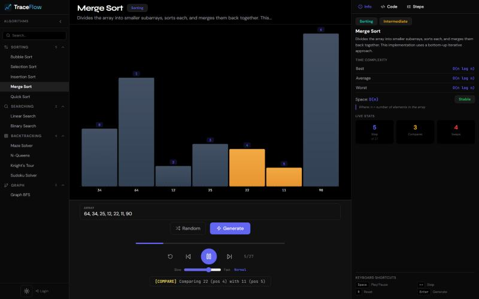
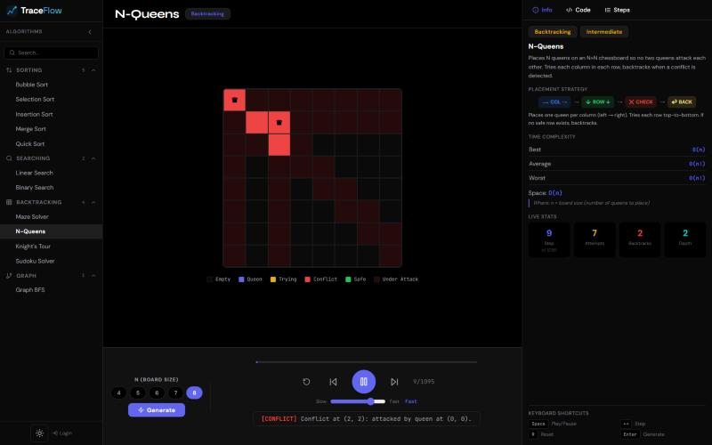
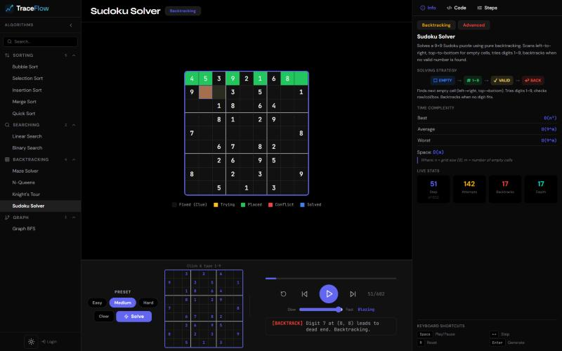
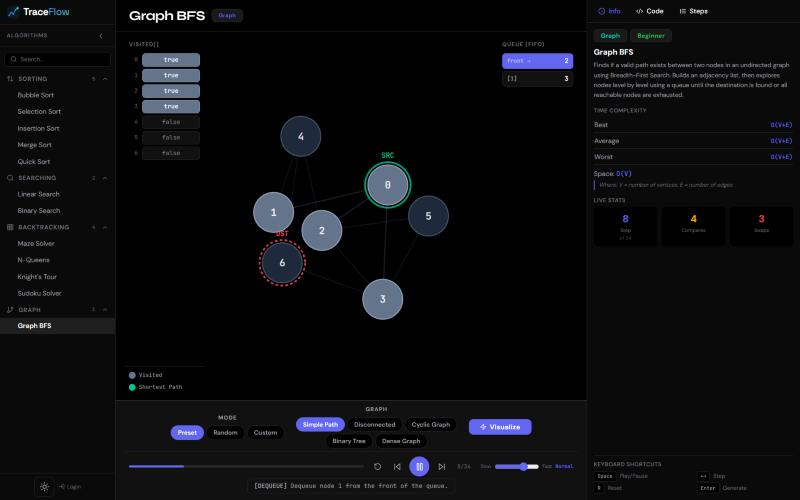

<div align="center">

# TraceFlow

### Learn algorithms by watching them run.

An interactive, step-by-step algorithm visualizer with pseudo-code tracing, live stats, quizzes and progress tracking.

[](https://traceflow-lake.vercel.app)


**[Try the live demo](https://traceflow-lake.vercel.app)** &nbsp;|&nbsp; **[Browse the algorithms](#-algorithms)** &nbsp;|&nbsp; **[Run it locally](#-getting-started)**

</div>

---

> **🚧 Project status: In development.**
> TraceFlow is a working prototype that I'm actively building. The core visualizer, accounts and quizzes work today; more algorithms and features are on the [roadmap](#-roadmap). The visualizer needs no login, so you can start exploring right away.

---

## ✨ Screenshots

<table>
  <tr>
    <td width="50%"><br/><sub><b>Sorting</b> - Merge Sort with animated bars, step counter and live compare/swap stats</sub></td>
    <td width="50%"><br/><sub><b>Backtracking</b> - N-Queens showing conflicts, attempts and backtracks</sub></td>
  </tr>
  <tr>
    <td width="50%"><br/><sub><b>Sudoku Solver</b> - watch the solver try digits and backtrack on dead ends</sub></td>
    <td width="50%"><br/><sub><b>Graph BFS</b> - nodes, visited array and FIFO queue update step by step</sub></td>
  </tr>
</table>

---

## 🎯 Features

| | |
|---|---|
| ▶️ **Step-by-step playback** | Play, pause, step forward/back, reset and change speed for every algorithm |
| 🧠 **Explains every step** | A plain-English log tells you exactly what the algorithm is doing and why |
| 📊 **Live stats** | Steps, comparisons, swaps, attempts and backtracks update as it runs |
| 📈 **Complexity at a glance** | Best / average / worst time complexity and space complexity for each algorithm |
| 💻 **Pseudo-code tracing** | Follow along with the code panel while the algorithm runs |
| 🎛️ **Your own input** | Type your own array, pick the board size, load Sudoku presets or build custom graphs |
| ⌨️ **Keyboard shortcuts** | `Space` play/pause, `←` `→` step, `R` reset, `Enter` generate |
| 🔍 **Quick search** | Find any algorithm instantly from the sidebar |
| 🧩 **Quizzes** | Test what you learned and track your best scores |
| 💾 **Save and revisit** | Save visualizations with notes and track your progress (with an account) |
| 🌗 **Dark and light themes** | Responsive layout that works on desktop and mobile |

---

## 📚 Algorithms

**12 algorithms across 4 categories** - and growing.

| Algorithm | Category | Difficulty | Worst-case time |
|---|---|---|---|
| Bubble Sort | Sorting | Beginner | O(n²) |
| Selection Sort | Sorting | Beginner | O(n²) |
| Insertion Sort | Sorting | Beginner | O(n²) |
| Merge Sort | Sorting | Intermediate | O(n log n) |
| Quick Sort | Sorting | Intermediate | O(n²) |
| Linear Search | Searching | Beginner | O(n) |
| Binary Search | Searching | Intermediate | O(log n) |
| Maze Solver | Backtracking | Beginner | O(V) |
| N-Queens | Backtracking | Intermediate | O(n!) |
| Knight's Tour | Backtracking | Advanced | O(8^(n²)) |
| Sudoku Solver | Backtracking | Advanced | O(9^m) |
| Graph BFS | Graph | Beginner | O(V+E) |

---

## 🗺️ Roadmap

TraceFlow is still growing. Here's what's planned:

- [x] Core visualizer engine with playback controls and pseudo-code tracing
- [x] Sorting, searching, backtracking and graph (BFS) visualizers
- [x] User accounts, saved visualizations, quizzes and progress tracking
- [x] Deployed live on Vercel
- [ ] **More algorithms:** DFS, Dijkstra, A*, Kruskal, Prim, Heap Sort, Counting/Radix Sort
- [ ] **New visualizers:** trees (BST, AVL, heaps), dynamic programming tables, linked lists, hash tables
- [ ] Side-by-side algorithm comparison mode
- [ ] Persistent hosted database (PostgreSQL) so accounts survive redeploys
- [ ] Password reset, email verification and rate limiting
- [ ] Automated tests and CI
- [ ] Share and export visualizations

---

## 🏗️ Architecture

```
┌──────────────────────────────────────────────────────────┐
│                        BROWSER                           │
│  React 18 + React Router                                 │
│  ┌─────────┬───────────────────┬──────────────┐          │
│  │ Sidebar │    Visualizer     │  Right Panel │          │
│  │ (algos) │ (D3 / grid / SVG) │ (Info, Code, │          │
│  │         │                   │  Step log)   │          │
│  └─────────┴───────────────────┴──────────────┘          │
│  Context: Auth | Trace | Toast   ·   Framer Motion       │
└───────────────────────┬──────────────────────────────────┘
                        │  Axios (credentials: true)
                        ▼
┌──────────────────────────────────────────────────────────┐
│                  EXPRESS API  (/api)                     │
│  /api/auth        register, login, profile, saved, quiz  │
│  /api/algorithms  algorithm metadata                     │
│  /api/progress    per-user progress                      │
│                                                          │
│  SQLite (better-sqlite3)  ·  JWT in httpOnly cookies     │
└──────────────────────────────────────────────────────────┘
```

**How the algorithm engine works:** every algorithm is a pure function that pre-computes a list of *steps* (state snapshots plus an explanation). The playback engine simply walks through that list, so stepping forward, backward and changing speed all come for free.

---

## 🚀 Getting started

**Prerequisites:** Node.js 18+ and npm 9+

```bash
# 1. Clone the repo
git clone https://github.com/krithickvivek/TraceFlow.git
cd TraceFlow

# 2. Backend
cd server
npm install
cp .env.example .env      # set a strong JWT_SECRET
node index.js             # http://localhost:4000

# 3. Frontend (in a second terminal)
cd client
npm install
npm run dev               # http://localhost:5173
```

### Environment variables (`server/.env`)

| Variable | Default | Description |
|---|---|---|
| `PORT` | `4000` | API server port |
| `JWT_SECRET` | *(required)* | Secret used to sign login cookies - change it! |
| `NODE_ENV` | `development` | Environment mode |
| `CLIENT_ORIGIN` | `http://localhost:5173` | Allowed CORS origin in development |

---

## ➕ Adding a new algorithm

The registry makes this a three-step job:

1. **Create** `client/src/algorithms/yourAlgo.js` exporting `metadata`, `generateSteps` and `pseudoCode`
2. **Register** it in `client/src/algorithms/index.js` with a `visualizerType` (`bar`, `grid`, `sudoku` or `graph`)
3. **Add an icon** in `Sidebar.jsx` only if you introduce a new category

The sidebar, info panel and pseudo-code panel pick it up automatically.

---

## 🔌 API reference

| Method | Endpoint | Auth | Description |
|---|---|:---:|---|
| POST | `/api/auth/register` | - | Create an account |
| POST | `/api/auth/login` | - | Log in |
| POST | `/api/auth/logout` | - | Log out |
| GET | `/api/auth/me` | ✅ | Current user |
| PUT | `/api/auth/profile` | ✅ | Update profile |
| GET / POST | `/api/auth/saved` | ✅ | List / save visualizations |
| PUT / DELETE | `/api/auth/saved/:id` | ✅ | Edit notes / delete a saved item |
| GET / POST | `/api/auth/quiz` | ✅ | Quiz scores / save a score |
| GET | `/api/auth/quiz-stats` | ✅ | Aggregated quiz stats |
| GET | `/api/algorithms` | - | Algorithm metadata |
| GET / POST | `/api/progress` | ✅ | Get / save algorithm progress |

---

## ⚠️ Notes on the live demo

The demo runs on Vercel's serverless platform, where the SQLite file is temporary. **Accounts and saved data may reset periodically.** The visualizer itself needs no account. Moving to a hosted database is on the roadmap.

---

## 👤 Author

**Krithick** - [@krithickvivek](https://github.com/krithickvivek)

Built as a portfolio project while learning data structures, algorithms and full-stack development. Feedback and ideas are welcome - feel free to open an issue.

---

## 📄 License

MIT
